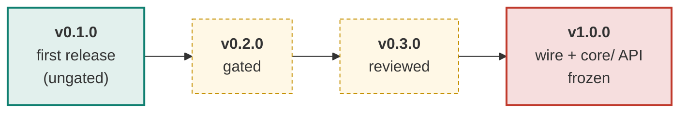
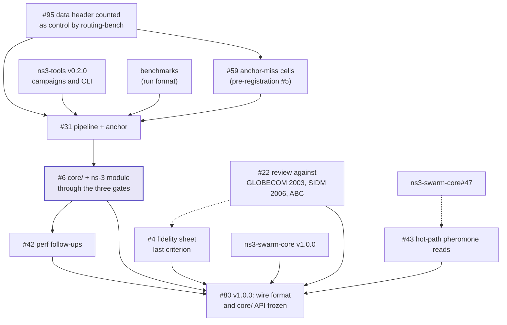

# Roadmap

The plan in one page. The live plan is this page plus the `release:` labels
below; issue state is always truer than a checked-in diagram. The release
ladder was adopted by the maintainer on 2026-11-11 ("adopt the release ladder
and replace the phase-targets rule"), after the model of
[AntHocNet's roadmap](https://github.com/swarm-routing/AntHocNet/blob/main/docs/roadmap.md).
Termite was a Phase 5 target of the org ROADMAP; it now has versions instead.

## How this plan is tracked

Each issue a release gates carries a **`release:` label**, so every row of
this plan is a live query rather than a diagram that drifts:

| Release | Board |
|---|---|
| v0.2.0 | [`release:v0.2.0`](https://github.com/swarm-routing/Termite/issues?q=is%3Aopen+label%3A%22release%3Av0.2.0%22) |
| v0.3.0 | [`release:v0.3.0`](https://github.com/swarm-routing/Termite/issues?q=is%3Aopen+label%3A%22release%3Av0.3.0%22) |
| v1.0.0 | [`release:v1.0.0`](https://github.com/swarm-routing/Termite/issues?q=is%3Aopen+label%3A%22release%3Av1.0.0%22) |
| all epics | [`epic`](https://github.com/swarm-routing/Termite/issues?q=is%3Aopen+label%3Aepic) |

Only issues a release actually gates are labelled. Majors are reserved for
breaking changes; v1.0.0 is the stability promise (wire format and `core/`
API frozen, paper-faithful with the deviations documented, the three gates
passed, green on the supported ns-3 release).

## Release ladder

Green is shipped, amber is planned. v0.1.0 shipped on 2026-11-11
([release v0.1.0](https://github.com/swarm-routing/Termite/releases/tag/v0.1.0)).

## What blocks what

Solid arrows are hard dependencies; dashed are "informs". Cross-repository
dependencies are named `swarm-routing/<repo>#N`.

**The sequencing rule worth memorising:** the anchor miss is explained before
the anchor is claimed. AntHocNet's arm passed the delivery smoke but missed its
anchor in v2.5.0 (trend right, confidence intervals span zero, danieljoppi/AntHocNet#587);
the pre-registration on [#5](https://github.com/swarm-routing/Termite/issues/5) (closed 2026-11-11) chose the cells, and [#59](https://github.com/swarm-routing/Termite/issues/59) runs them and applies the decision rule.

The router observer is no longer in the picture: [#41](https://github.com/swarm-routing/Termite/issues/41) (the core and the ns-3 half) closed on 2026-11-11 ([`observer.md`](observer.md)). [#95](https://github.com/swarm-routing/Termite/issues/95) is: the data header sits in front of the UDP header, so routing-bench would count every data hop as control, and it is fixed before #31 or #59 report overhead.

## What each release must show to ship

| Release | Exit criteria |
|---|---|
| **v0.1.0** | **Shipped 2026-11-11, ungated.** `core/` on swarm-core's primitives (the ch. 4 data path) and `docs/` (the fidelity sheet, [#4](https://github.com/swarm-routing/Termite/issues/4)) as they stood at the release commit. The `termite` contrib module was not in the release ([#37](https://github.com/swarm-routing/Termite/issues/37) closed later the same day), and the anchor was pending. |
| **v0.2.0** | **Gated.** The module is green on `debug` and `sanitized` with the determinism gate; the router observer is adopted; the protocol has its own benchmark pipeline; the anchor has a verdict (PASS, or a written infeasibility verdict); the fidelity open items are settled. Done: the router observer ([#41](https://github.com/swarm-routing/Termite/issues/41), closed 2026-11-11). Open: • [#59](https://github.com/swarm-routing/Termite/issues/59): run the pre-registered anchor-miss cells from [#5](https://github.com/swarm-routing/Termite/issues/5) and apply its decision rule. • [#6](https://github.com/swarm-routing/Termite/issues/6): the protocol issue's remaining acceptance criteria (gates recorded in `benchmarks`; AntHocNet's arm removed with the byte-identical check). • [#31](https://github.com/swarm-routing/Termite/issues/31): paired smoke and anchor campaigns against the base, on the org reusable cell workflow (needs ns3-tools v0.2.0). |
| **v0.3.0** | **Reviewed.** The paper-review issues, the performance follow-ups and default-off A/Bs. • [#4](https://github.com/swarm-routing/Termite/issues/4): the fidelity sheet's last criterion. • [#22](https://github.com/swarm-routing/Termite/issues/22): review the sheet against GLOBECOM 2003, SIDM 2006 and ABC once they are in hand. • [#42](https://github.com/swarm-routing/Termite/issues/42): zero-copy overhear, cached ipv4, one-pass decay. • [#43](https://github.com/swarm-routing/Termite/issues/43): hot-path pheromone reads off `entries()` (swarm-routing/ns3-swarm-core#47). |
| **v1.0.0** | **Stable.** Wire format and `core/` API frozen; a released run recorded in the `benchmarks` global suite. • [#80](https://github.com/swarm-routing/Termite/issues/80): freeze the wire format and the `core/` API, with the gates passed (after v0.2.0, v0.3.0 and ns3-swarm-core v1.0.0). |

Not gating, so not labelled: the epic [#3](https://github.com/swarm-routing/Termite/issues/3) and the handoff [#7](https://github.com/swarm-routing/Termite/issues/7). [#95](https://github.com/swarm-routing/Termite/issues/95) carries no `release:` label either; it is drawn above because the overhead numbers of #31 and #59 wait for it.

## Infrastructure track

CI, org-template and settings work rides along with whichever release is next
and never gates one, so it carries no `release:` label and is never an exit
criterion. No item is scheduled yet.

## Deliberate non-goals

- **A v1.0.0 before the gates.** v1.0.0 promises a frozen wire format and
  `core/` API; it waits for v0.2.0 (anchor verdict) and v0.3.0 (paper review).
- **Mechanisms beyond the papers by default.** Any addition ships as a
  default-off mechanism with its own A/B on identical seeds, as in AntHocNet.
- **Nothing is deferred past 1.0 yet.** Work found later is filed and labelled
  into a release only when that release depends on it.

## See also

- The org [ROADMAP](https://github.com/swarm-routing/.github/blob/main/ROADMAP.md): the cross-repository release train.
- [CONTRIBUTING](https://github.com/swarm-routing/.github/blob/main/CONTRIBUTING.md): labels and issue shape.
- [AntHocNet's roadmap](https://github.com/swarm-routing/AntHocNet/blob/main/docs/roadmap.md): the model for this page.
- [`fidelity.md`](fidelity.md) and [`observer.md`](observer.md).
